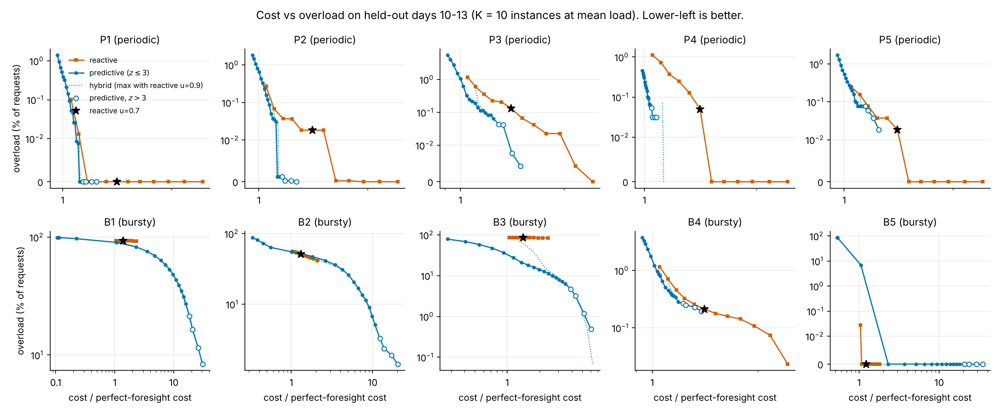
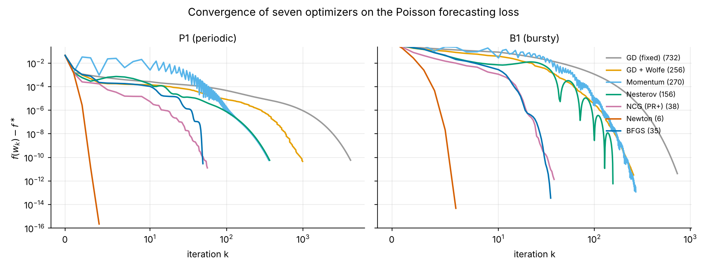
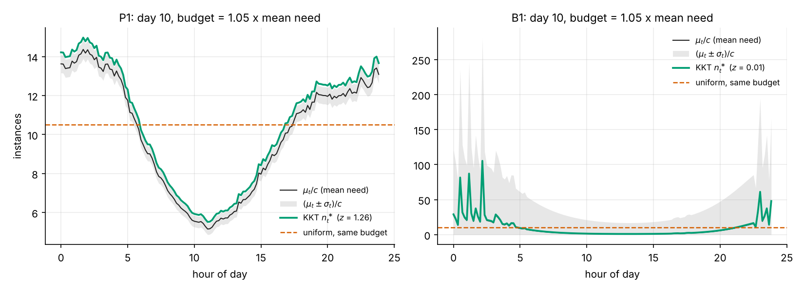
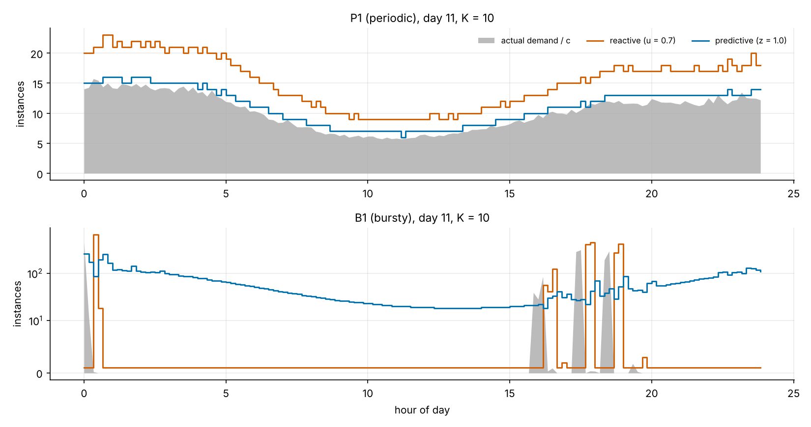

# Predictive Autoscaling with Classical Optimization

Forecast serverless traffic 20 minutes ahead, decide how many instances to run under a
budget, and replay real Azure Functions traffic to compare against reactive
(target-tracking) autoscaling. Every optimizer is implemented from scratch in NumPy:
GD, GD + Wolfe line search, momentum, Nesterov, nonlinear CG, Newton, BFGS, and a
KKT/bisection solver for the budget-constrained allocation. SciPy is used only to
cross-check answers.

*CSME 831 (Computational Optimization) final project, Michigan State University.*
Full write-up: [`report/report.md`](report/report.md) · slides: [`report/slides.md`](report/slides.md)

**Platform layer** ([`platform/`](platform/README.md)): the same model deployed as a small
production-style system: a PySpark ETL over the raw trace, a Kafka stream processor that
emits scaling decisions every 10 minutes with crash-safe state, and an Airflow DAG that
retrains daily and hot-swaps models. Every layer is verified against the offline study
(0 mismatches over 5,780 streamed decisions).

## Key results

| Question | Result |
|---|---|
| Which optimizer fits the Poisson forecast model best? | **Newton**: 2–9 iterations, < 1.1 ms on all 10 apps. First-order iteration counts track log κ(H) (r = 0.91–0.99). |
| Does the textbook step α = 1/λ_max(H(w₀)) work? | **No.** It diverged on 2 of 10 apps and stalled on a third. The Poisson loss is not globally L-smooth; curvature at the optimum is 3–5× larger on bursty apps. |
| Optimal budgeted allocation? | The KKT conditions give an **equal-quantile rule**: c n_t = μ_t + z σ_t in every interval. Bisection on the multiplier matches SLSQP to ≤ 1.3·10⁻⁸ relative gap and is 10–300× faster on a full day. |
| Predictive vs reactive on periodic apps? | **~20% cost saving at equal overload**, stable for 5–50 instances per app. Dominates reactive in 12–13 of 15 comparisons. |
| …on bursty apps? | **No reliable edge.** Predictive wins only where reactive fails completely, and costs 38–88% more when traffic levels shift. A hybrid max(predictive, reactive) caps the worst case at +4–11%. |



## Pipeline

```
raw trace ──► prepare_data ──► data/series.npz (10 apps × 2016 ten-minute bins)
                                   │
                ┌──────────────────┴─────────────────┐
                ▼                                     │
   features + Poisson model (model.py)                │
                ▼                                     │
   optimizers.py ──► Part 1 benchmark                 │
                ▼                                     │
   forecast μ_t, σ_t (20 min ahead)                   │
                ▼                                     ▼
   capacity.py (KKT) ──► Part 2       simulate.py replays real traffic ──► Part 3
```

## Data

[Azure Functions 2019 trace](https://github.com/Azure/AzurePublicDataset) (Shahrad et al.,
*Serverless in the Wild*, USENIX ATC'20, CC BY 4.0), with per-minute invocations over 14 days.
Of the 623 apps with ≥ 50 invocations/min on day 1, 565 are active all 14 days. Each app is
classified by its daily autocorrelation (lag 144 in 10-minute bins) and p99/mean burstiness:
31 periodic and 17 bursty. The top 5 of each class are studied. Training uses days 2–9 and
testing uses days 10–13.

The raw trace (≈ 2 GB extracted) is not committed. `data/series.npz` (the 10 selected
series) is committed, so every part except `make data` runs without the download.

## Quick start

```bash
uv venv -p 3.11 .venv && uv pip install -p .venv -r requirements.txt
```

```bash
make all      # Part 1, 2, 3 and tests, from the committed data/series.npz
```

```bash
make data     # optional: download the trace (~145 MB) and rebuild data/series.npz
```

Python 3.11, numpy, pandas, scipy, matplotlib. `make all` takes about a minute.

## Repository layout

```
src/
  prepare_data.py       trace → per-app 10-min series, periodic/bursty classification
  model.py              features, penalized Poisson loss, gradient, Hessian, WAPE
  optimizers.py         GD, GD+Wolfe, Momentum, Nesterov, NCG (PR+), Newton, BFGS, line searches
  capacity.py           budgeted allocation: KKT + bisection, Φ⁻¹ by Newton, SLSQP cross-check
  simulate.py           reactive / predictive policies, cost and overload metrics
  part1_optimizers.py   RQ1 benchmark, forecasts → results/forecasts.npz
  part2_capacity.py     RQ2 allocation, KKT vs SLSQP, budget frontier
  part3_simulation.py   RQ3 replay, frontiers, equal-cost comparison, sensitivity over K
tests/                  gradient check, optimizers on quadratics, KKT vs SLSQP, simulator
results/                all CSVs and figures (committed)
report/                 report.md, slides.md
```

## Results by part

### Part 1: optimizers (RQ1)

Iterations to ‖∇f‖ < 10⁻⁶ (5000 = cap reached). Full table: `results/part1_benchmark.csv`.

| app | κ(H\*) | GD | GD+Wolfe | Momentum | Nesterov | NCG | Newton | BFGS |
|---|---|---|---|---|---|---|---|---|
| P1 | 624 | 4170 | 985 | 356 | 365 | 56 | 4 | 49 |
| P3 | 1463 | 5000 | 2164 | 1040 | 1047 | 92 | 6 | 63 |
| B1 | 67 | 732 | 256 | 270 | 156 | 38 | 6 | 35 |
| B5 | 3756 | 5000 | 5000 | 2812 | 2844 | 146 | 9 | 63 |



Forecast WAPE on test days: periodic apps 2.2–4.7% vs 2.6–15.8% for "same time yesterday".
Bursty apps 5–194%, so they are poorly forecast, as expected.

### Part 2: capacity allocation under a budget (RQ2)

Minimize expected unserved demand Σ E[(D_t − c n_t)⁺] subject to p Σ n_t = B and n_t ≥ n_min.
Stationarity gives c(1 − F_t(c n_t)) = λp: every interval gets the same marginal overload
reduction per dollar, i.e. the same quantile z. At equal budget, the optimal allocation has
20–70× less expected overload than a flat allocation on periodic apps.



### Part 3: replay on held-out days (RQ3)

Reactive: n_t = ⌈y_{t−2}/(c·u)⌉. Predictive: n_t = ⌈(μ_t + zσ_t)/c⌉. Both decide 20 minutes
ahead. Summary across K = 5/10/20/50 instances at mean load (`results/part3_summary.csv`):

| class | predictive dominates reactive | median cost saving at equal overload | worst case |
|---|---|---|---|
| periodic | 12–13 / 15 | 18–20% | +2.4% (still cheaper) |
| bursty | 8 / 15 | 2–4% | −61% to −177% (predictive costs more) |



## How this would run in production (design only, not implemented)

```
CloudWatch metrics ──► EventBridge schedule (every 10 min) ──► Lambda: forecaster
 (RequestCount per target,                                        │ fit Poisson GLM (Newton, < 1 ms/app)
  per-minute, 14-day history)                                     │ μ_t, σ_t for t+2 … t+N
                                                                  ▼
                                         Lambda: capacity optimizer (KKT/bisection for budget B,
                                                  or fixed z from an SLO)
                                                                  ▼
                              EC2 Auto Scaling scheduled actions: set MinSize = n_t, 20 min ahead
                                                                  +
                              target-tracking policy (u ≈ 0.9) kept as the reactive safety net
```

- **Data.** Request-count metrics per Auto Scaling group from CloudWatch (`GetMetricData`),
  aggregated to 10 minutes, with the last 14 days kept.
- **Forecaster.** A scheduled Lambda refits the model per service. With 10 features, Newton
  converges in a few iterations, so frequent refits are cheap and help with level shifts
  (the B2/B5 failure mode). φ is re-estimated each run.
- **Optimizer.** Turns (μ_t, σ_t) into n_t. Either z is set from an availability target, or
  z is chosen by bisection so that planned spend meets a daily budget. λ is reported as the
  marginal value of budget.
- **Actuation.** Writes `PutScheduledUpdateGroupAction` entries that raise **MinSize** to n_t
  ahead of each interval. Raising the minimum, rather than setting desired capacity, leaves
  the reactive policy free to add more.
- **Safety net.** A target-tracking policy on the same group covers forecast misses. Running
  the hybrid max(predictive, reactive u = 0.9) cut the worst-case bursty cost penalty from
  61–177% to 4–11% in the simulation. A guard falls back to reactive-only when recent WAPE
  exceeds a threshold (e.g. bursty apps).

**Comparison with AWS Predictive Scaling** (per the EC2 Auto Scaling user guide):

| | AWS Predictive Scaling | This design |
|---|---|---|
| History | needs ≥ 24 h, uses up to 14 days | 2 days of lags + 8 days training |
| Forecast | hourly granularity, next 48 h, refreshed every 6 h | 10-min granularity, 20 min ahead, refit every run |
| Lead time | scales at the start of each hour; `SchedulingBufferTime` ("pre-launch instances") launches earlier | lead time H = 20 min built into features and simulation |
| Combination with dynamic scaling | each policy computes desired capacity independently; **the maximum wins** | same max rule (hybrid) |
| Scale-in | predictive policy does not scale in; dynamic policies remove capacity | MinSize lowered on schedule; target tracking scales in |
| Safe rollout | "forecast only" mode before "forecast and scale" | run forecaster and log n_t before writing scheduled actions |
| Good fit | cyclical, recurring daily/weekly patterns, slow-initializing apps | same conclusion: ~20% savings on periodic, no edge on bursty |
| Uncertainty / budget | not exposed | explicit quantile z and budget multiplier λ |

## Limitations

The study assumes a fixed capacity c per instance (conclusions checked for K = 5–50). It uses
a Gaussian quasi-Poisson approximation, which is poor for bursty traffic. Data is aggregated
to 10 minutes, so minute-level spikes and queueing are not modelled. It covers 2019 traffic,
10 apps and 4 test days. See §7 of the report.

## Data license and citation

Azure Public Dataset (CC BY 4.0). Shahrad et al., "Serverless in the Wild: Characterizing and
Optimizing the Serverless Workload at a Large Cloud Provider", USENIX ATC 2020.
