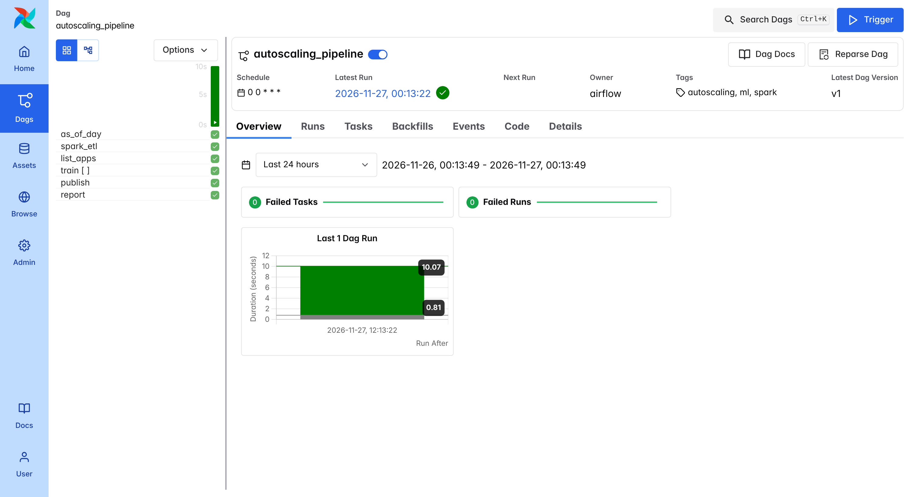

# Platform layer: Spark ETL · Kafka streaming scaler · Airflow retraining

This folder turns the [course study](../README.md) into a small production-style
system. The forecasting model and scaling policy are the same code (`src/model.py`,
`src/optimizers.py`), imported rather than copied, and each layer is checked against
the offline results.

It is kept separate from the course submission, which only uses
numpy/pandas/scipy/matplotlib, and has its own dependencies (`platform/requirements.txt`).

```
 Azure trace (14 daily CSVs, ~2 GB)
        │
        ▼
 ┌─────────────────────┐   Parquet lake: app_stats, series_10min, minute_selected
 │ PySpark ETL         │──────────────────────────────────────────────┐
 │ spark/aggregate_... │                                              │
 └─────────────────────┘                                              │
        ▲ (Airflow task)                                              ▼
 ┌─────────────────────────────────────────────┐      ┌──────────────────────────────┐
 │ Airflow DAG  autoscaling_pipeline  (@daily) │      │ producer.py                  │
 │  spark_etl → list_apps → train[app] ×10     │      │ replays per-minute traffic   │
 │  (dynamic task mapping, holdout WAPE gate)  │      │ key = app                    │
 │  → publish (atomic LATEST switch) → report  │      └──────────────┬───────────────┘
 └───────────────────────┬─────────────────────┘                     │ topic: invocations (3 partitions)
                         │ model registry (versioned JSON)           ▼
                         │                         ┌──────────────────────────────────────┐
                         └── hot reload ─────────► │ scaler.py (consumer group)           │
                                                   │ 10-min event-time windows per app    │
                                                   │ forecast μ,σ → n = max(pred, react)  │
                                                   │ state + offsets checkpointed together│
                                                   └──────────────┬───────────────────────┘
                                                                  │ topic: scaling-decisions
                                                                  ▼
                                                   verify.py: recompute every decision offline
```

## What each component does

| Component | Technology | Key points |
|---|---|---|
| `spark/aggregate_trace.py` | PySpark 4.0 | Wide 1,440-column aggregation per (app, day), busy/active filter, `posexplode` to 11.4M (app, minute) rows, 10-minute bins, exact p99 and lag-144 autocorrelation via window functions, periodic/bursty selection. Writes Parquet. |
| `streaming/producer.py` | Kafka (confluent-kafka) | Replays per-minute traffic keyed by app (per-app ordering). Idempotent producer, `acks=all`, lz4. Optional real-time pacing (`--speed`). |
| `streaming/scaler.py` | Kafka consumer group | Event-time tumbling windows per app. When interval k closes, it forecasts k+2 (20 min ahead) and emits `n = max(⌈(μ+zσ)/c⌉, ⌈y_k/(c·u)⌉)`. Window state and input offsets are checkpointed atomically, so a crash never double-counts. Decisions are deterministic and upserted by (app, interval). Models hot-reload when the registry changes. |
| `airflow/dags/autoscaling_pipeline.py` | Airflow 3 (TaskFlow) | Daily retrain on the latest 8 days. One mapped task per app, with independent retries. Validation gate: holdout WAPE > 25% puts the app in reactive-only mode. All-or-nothing publish. JSON run report. |
| `autoscaler/` | Python | Shared code: forecaster artifact (JSON), policy, file-based registry with atomic version switch. |
| `docker-compose.yml` | Docker | Kafka (KRaft) + topic init + Airflow + scaler, plus producer/verify as one-off tools. |

## Verified results

Every check below was run (`platform/tests`, 19 tests, plus the end-to-end demo):

| Check | Result |
|---|---|
| Spark ETL vs pandas pipeline | Same 623 busy / 565 active apps, same 31 periodic / 17 bursty classes. Statistics equal to 1e-9; series and per-minute data identical. About 165 s on 4 local cores. |
| Deployable forecaster vs course Part 1 | μ_t identical to 1e-8 on all 10 apps (JSON round trip included) |
| Kafka end to end (57,600 messages, test days 10–13) | 5,780 decisions, **0 missing, 0 mismatches** vs offline recomputation |
| Crash recovery (hard kill after 25,000 messages, restart) | Resumed from checkpointed offsets, replayed the lost batch, **still 0 mismatches**, so no window was double-counted |
| Daily retrain loop (Airflow publishes day 11, 12, 13 while the scaler runs) | 3 hot reloads. Each decision verified against the model version that made it: day10 1,450 · day11 1,440 · day12 1,440 · day13 1,430. |
| Docker compose stack | Kafka, topics, Airflow-trained model, scaler, producer and verify all run in containers; verify OK. Airflow UI run below. |
| Validation gate | P1–P5 and B4 → hybrid (holdout WAPE 1–5%). B1, B2, B3, B5 → reactive-only (WAPE 54–205%), consistent with the study's finding that these apps cannot be forecast. |



**Operating point of the demo** (z = 1, safety net u = 0.9, `results/streaming_verify.csv`).
Hybrid apps run at 0.01–0.15% overload (B4: 0.53%). Costs are 19–22% below a reactive policy
at u = 0.7, **but that is not a like-for-like comparison**: the reactive-only apps are also
13–22% cheaper, just from the leaner u. The fair equal-overload comparison (about 20%
saving on periodic apps) is in the [course study](../report/report.md#6-part-3--simulation-on-held-out-days-rq3).

## Run it

Native (Kafka binary + Python 3.11 venv):

```bash
uv venv -p 3.11 .venv-platform && uv pip install -p .venv-platform -r platform/requirements.txt -c https://raw.githubusercontent.com/apache/airflow/constraints-3.0.6/constraints-3.11.txt
```

```bash
make -f platform/Makefile spark      # needs the raw trace: `make data` first (~145 MB download)
```

```bash
make -f platform/Makefile kafka-up   # KAFKA_HOME=/path/to/kafka_2.13-3.9.1
```

```bash
make -f platform/Makefile demo       # Airflow day 10 → stream days 10-13 with daily retrain → verify
```

```bash
make -f platform/Makefile test
```

Docker:

```bash
docker compose -f platform/docker-compose.yml up -d --build
```

```bash
docker compose -f platform/docker-compose.yml run --rm producer
```

```bash
docker compose -f platform/docker-compose.yml run --rm verify
```

The Airflow UI is at http://localhost:8080. User `admin`; the generated password is in
`/opt/airflow/simple_auth_manager_passwords.json.generated` inside the `airflow` container.

Without the raw trace, the producer and training fall back to the committed
`data/series.npz` (10-minute counts), so everything except the Spark job still runs.

## Design notes

- **Why checkpoint offsets with state instead of Kafka auto-commit.** Window counts are
  aggregates. Replaying a message that is already in the state would double-count it.
  Storing the offsets next to the state (one atomic file write, after the batch's decisions
  are flushed) makes state updates effectively exactly-once. Decisions are at-least-once, but
  deterministic and keyed, so consumers upsert. With Kafka transactions this would become a
  `read-process-write` transaction; in production, state would live in RocksDB/Flink or a
  database rather than a JSON file.
- **Why a validation gate.** The study showed predictive scaling loses on unforecastable
  apps. The DAG measures holdout WAPE on the last training day and turns prediction off for
  those apps, falling back to target tracking, instead of trusting the model blindly.
- **Why max(predictive, reactive).** This is the rule AWS uses when predictive and dynamic
  scaling policies coexist. It caps the damage of a bad forecast.
- **Fixed instance capacity.** `c` is a property of the instance type, so it is configured
  once (days 2–9 mean / K) and does not drift with retraining.

## Limitations and honest notes

- Single broker, single scaler instance, file-based registry and checkpoint: a local
  stand-in for MSK/Kinesis, S3 and a state store. Scaling out the scaler would require
  per-partition checkpoints (the current file covers all assigned partitions).
- The Spark job runs in local mode. On a cluster the same script runs via `spark-submit`
  (EMR/Dataproc) with `s3a://` paths; Airflow would then use a SparkSubmit/EMR operator.
- The DAG maps logical dates onto trace days (day 0 = 2019-07-15, nominal), so a run is a
  replay of history, not live data.
- In the very first DAG run after creating the Airflow database, 7 of 10 train tasks failed,
  and the log was not captured. All later runs (each of days 10–13 at least twice, plus the Docker run)
  succeeded. Cause unknown; worth watching.
