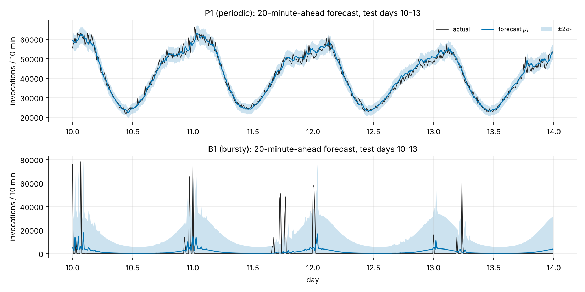
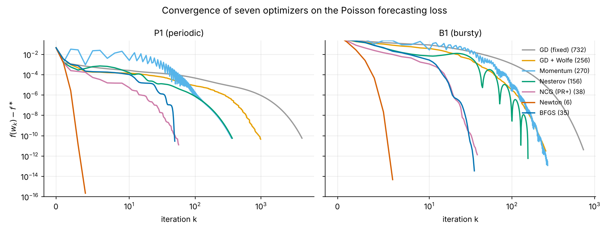
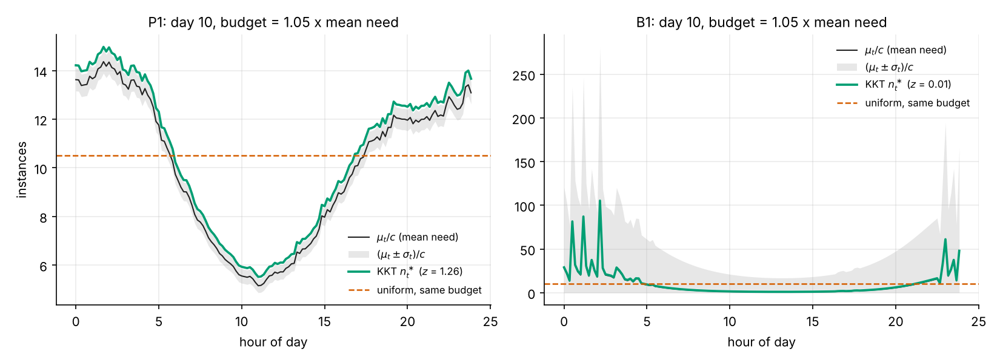
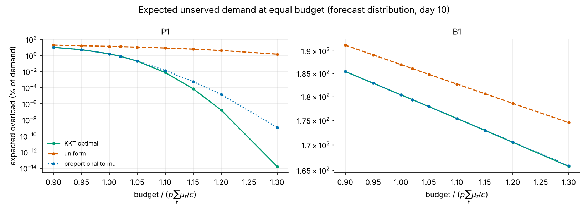
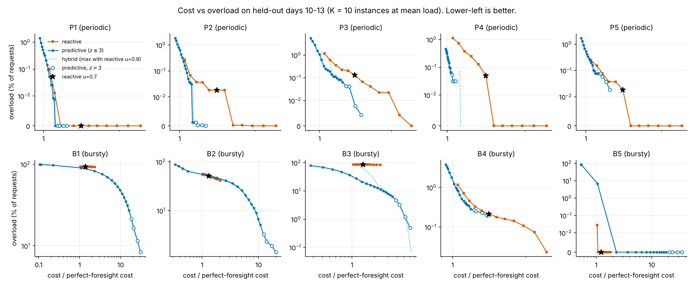
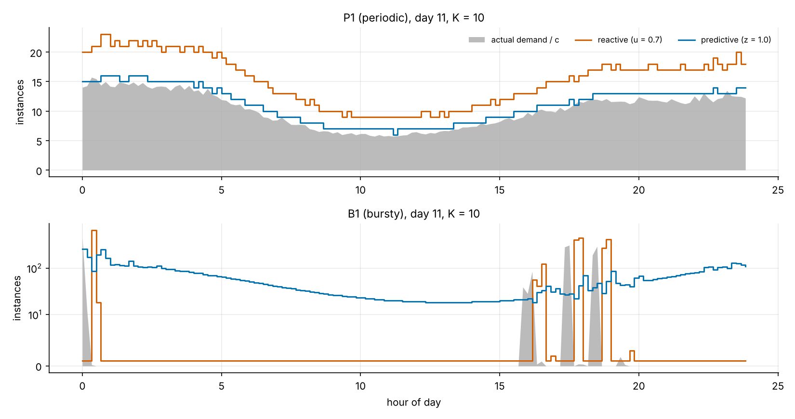

# 1. Introduction

A cloud service has to decide, every few minutes, how many instances to run.
Too few and requests queue or fail (overload); too many and money is wasted.
The common **reactive** autoscaler (e.g. target tracking) adds instances once
observed load crosses a threshold. Because a new instance needs several minutes
to boot and warm up, a reactive scaler is always one start-up time behind the
traffic. **Predictive** autoscalers — AWS Predictive Scaling, Azure predictive
autoscale, GCP predictive autoscaling — forecast load and provision ahead.

This project builds a small predictive autoscaler end to end on real serverless
traffic and uses it as a vehicle for the optimization methods of the course:

* **RQ1 (unconstrained optimization).** How do GD with fixed step, GD with a Wolfe
  line search, heavy-ball momentum, Nesterov, nonlinear CG, Newton and BFGS compare
  when fitting the forecasting model (iterations, wall time, robustness), and how
  does this relate to the condition number of the Hessian?
* **RQ2 (constrained optimization).** Given a budget, what is the optimal
  allocation of instances over time, and what do the KKT conditions say about it?
* **RQ3 (application).** Does predictive autoscaling beat reactive autoscaling on
  cost vs. overload, and does that depend on whether the workload is periodic or bursty?

**Hypotheses.** H1: Newton converges in a handful of iterations (convex, d = 10);
first-order methods slow down as cond(H) grows. H3: predictive scaling wins on
periodic applications and loses its edge on bursty ones.

**Course mapping.**

| Course topic | Where it is used |
|---|---|
| Day 4 – convexity | Convexity proof of the Poisson loss (§3.2) and of the allocation problem (§5.1) |
| Day 5 – finite differences, root finding | Gradient/Hessian check (§4.1); bisection for λ and Newton for Φ⁻¹ (§5.2) |
| Days 7–9 – GD, step bound 1/L, Wolfe | Fixed-step GD, the 1/L pitfall (§4.3), strong-Wolfe line search (§4.2) |
| Day 10 – momentum, Nesterov | Heavy-ball and Nesterov (§4.2) |
| Day 12 – nonlinear CG | Polak–Ribière+ with restarts (§4.2) |
| Days 13–14 – Newton, BFGS | Newton with Armijo backtracking, BFGS with NW eq. 6.20 scaling (§4.2) |
| Days 14–15 – Lagrange multipliers, KKT | Budgeted allocation, equal-quantile rule (§5) |

All optimizers are implemented from scratch in NumPy (`src/optimizers.py`,
`src/capacity.py`); SciPy is used only to cross-check answers.

# 2. Data

**Source.** Azure Functions 2019 trace (Shahrad et al., 2020; CC BY 4.0): per-minute
invocation counts for every function over 14 days. We sum functions per application.

**Selection.** Apps with mean ≥ 50 invocations/min on day 1: **623**; of these, present in
all 14 daily files: **565**. Each app is aggregated to 10-minute bins (2016 points) and classified by

* acf = autocorrelation of the 10-minute series at lag 144 (one day),
* burstiness = p99 / mean of the per-minute series.

| class | rule | apps |
|---|---|---|
| periodic | acf > 0.8, p99/mean < 3, mean > 100/min | 31 |
| bursty | \|acf\| < 0.15, p99/mean > 8, mean > 100/min | 17 |

We keep the top 5 periodic apps (highest acf) and the top 5 bursty apps (highest p99/mean),
named P1–P5 and B1–B5 (`results/selected_apps.csv`).

*Note on counts.* Preliminary exploration had reported 63 periodic and 28 bursty apps.
Implemented exactly as specified we get 31 and 17; dropping the mean > 100/min filter
reproduces 28 bursty, but no variant tried (acf on 1-minute data, p99 on 10-minute data)
reproduces 63 periodic. This does not affect the study, which uses the top 5 of each class.

**Split.** Days 0–1 only provide lags; training = days 2–9 (1152 intervals), test = days 10–13 (576).

**Two caveats found in the data** (they matter for RQ3): on the test days B5 runs at 9 % and
B2 at 26 % of their training-period level (a regime change), and B1 is zero in 94 % of
test intervals (its traffic is a few large bursts per day).

# 3. Forecasting model

## 3.1 Model

The decision lead time is H = 2 intervals (20 minutes, roughly instance start-up). The count
in interval t is forecast from information available at t − 2:

x_t = [1, log1p(y_{t−2}), log1p(y_{t−3}), log1p(y_{t−4}), log1p(y_{t−144}), log1p(y_{t−288}),
sin/cos(2πh/24), sin/cos(4πh/24)],

with non-intercept columns standardized using training statistics and the target divided by
its training mean (so w = 0 predicts the mean, a well-scaled start). The model is Poisson
regression with log link, fitted by minimizing

  f(w) = (1/n) Σᵢ [exp(xᵢᵀw) − yᵢ xᵢᵀw] + (λ/2)‖w₁:‖², λ = 10⁻³ (intercept not penalized),

  ∇f(w) = Xᵀ(μ − y)/n + λPw, ∇²f(w) = Xᵀ diag(μ) X / n + λP,

where μ = exp(Xw) and P = diag(0, 1, …, 1).

## 3.2 Convexity (Day 4)

*Claim.* f is convex; it is strictly convex when X has full column rank.

*Proof.* For each i, z ↦ eᶻ is convex and w ↦ xᵢᵀw is affine, so w ↦ exp(xᵢᵀw) is convex
(convex ∘ affine). The term −yᵢxᵢᵀw is affine. The penalty (λ/2)wᵀPw is convex since P ⪰ 0.
Non-negative sums of convex functions are convex, so f is convex. Directly from the Hessian:
for any v,

  vᵀ∇²f(w)v = (1/n) Σᵢ μᵢ (xᵢᵀv)² + λ Σ_{j≥1} v_j² ≥ 0,

because μᵢ = exp(xᵢᵀw) > 0. If X has full column rank, Xv ≠ 0 for v ≠ 0, so the first sum is
strictly positive and ∇²f ≻ 0 everywhere: f is strictly convex, any stationary point is the
unique global minimizer, and the KKT/first-order condition ∇f = 0 is sufficient. ∎

*Remark (important for §4.3).* f is **not** L-smooth globally: λ_max(∇²f(w)) grows like
max_i μᵢ = max_i exp(xᵢᵀw), which is unbounded. Nor is it uniformly strongly convex,
since μᵢ → 0 in some directions. The classical guarantee "GD with α ≤ 1/L converges"
therefore only applies on a sublevel set, with L the maximal curvature *on that set*.

## 3.3 Uncertainty

For the capacity problem we need a predictive distribution. We use a quasi-Poisson
model, Var(D_t) = φ μ_t, with φ estimated from training Pearson residuals,
φ = Σ (y − μ)²/μ / (n − d), and the Gaussian approximation D_t ~ N(μ_t, φμ_t).
φ ranges from 1.5 (P4, nearly Poisson) to 4.7·10⁵ (B5) (`results/part1_forecast_accuracy.csv`).

## 3.4 Forecast accuracy on test days

WAPE = Σ|y − ŷ| / Σy, against the naive "same time yesterday" forecast ŷ_t = y_{t−144}.

| app | P1 | P2 | P3 | P4 | P5 | B1 | B2 | B3 | B4 | B5 |
|---|---|---|---|---|---|---|---|---|---|---|
| model WAPE | 3.2 % | 3.9 % | 4.7 % | 2.2 % | 3.5 % | 194 % | 128 % | 70 % | 5.4 % | 47 % |
| naive WAPE | 5.9 % | 8.6 % | 15.8 % | 2.6 % | 5.2 % | 170 % | 343 % | 116 % | 6.9 % | 1062 % |

Periodic apps are forecast to 2–5 % (naive: 3–16 %). Bursty apps are, as expected, poorly
forecast; the model still beats naive on 4 of 5 (the naive forecast replays yesterday's bursts),
but a WAPE above 100 % is useless for provisioning. B4 is "bursty" by the p99/mean rule
(short spikes inside minutes) but smooth at the 10-minute scale and is forecast well.
Figure `results/part1_forecast.png` shows P1 and B1.

# 4. Part 1 — Unconstrained optimization (RQ1)

## 4.1 Gradient check (Day 5)

The analytic gradient matches central differences, (f(w + he_i) − f(w − he_i))/(2h), with
h = 10⁻⁶ to relative error < 10⁻⁶, and the Hessian matches finite differences of the
gradient, on a periodic and a bursty app at random w (`tests/test_gradient.py`).

## 4.2 Methods and set-up

Same start w₀ = 0 for every method; stop when ‖∇f‖ < 10⁻⁶ or after 5000 iterations;
non-finite iterates are flagged as diverged (`np.seterr(all="ignore")`).

| method | details |
|---|---|
| GD (fixed) | α = 1/L, L = max(λ_max(H(w₀)), λ_max(H(w\*))) |
| GD + Wolfe | steepest descent, strong Wolfe (c₁ = 10⁻⁴, c₂ = 0.9), NW Alg. 3.5/3.6 with cubic interpolation; initial step NW eq. 3.60 |
| Momentum | heavy ball, v ← βv − α∇f, α = 1/L, β = 0.9 |
| Nesterov | y = w_k + β(w_k − w_{k−1}), w_{k+1} = y − α∇f(y), α = 1/L, β = 0.9 |
| NCG | Polak–Ribière+, strong Wolfe c₂ = 0.1, restart every d iterations or on non-descent |
| Newton | Cholesky solve, Armijo backtracking (ρ = 0.5) |
| BFGS | inverse-Hessian update, strong Wolfe c₂ = 0.9, H₀ = (sᵀy/yᵀy) I after the first step (NW eq. 6.20) |

The reference f\* comes from Newton run to ‖∇f‖ < 10⁻¹²; it agrees with SciPy's BFGS to
|Δf| ≤ 4·10⁻¹⁶ and ‖Δw‖ ≤ 6·10⁻⁸ on all 10 apps (`results/part1_conditioning.csv`).
The optimizers are also unit-tested on quadratics with known minimizer, κ ∈ {1, 10, 100}
(`tests/test_optimizers.py`).

## 4.3 Results

**Iterations to ‖∇f‖ < 10⁻⁶** (5000 = not converged; `results/part1_benchmark.csv`):

| app | κ(H\*) | GD | GD+Wolfe | Mom. | Nest. | NCG | Newton | BFGS |
|---|---|---|---|---|---|---|---|---|
| P1 | 624 | 4170 | 985 | 356 | 365 | 56 | 4 | 49 |
| P2 | 1201 | 5000 | 1506 | 649 | 654 | 74 | 4 | 57 |
| P3 | 1463 | 5000 | 2164 | 1040 | 1047 | 92 | 6 | 63 |
| P4 | 168 | 741 | 372 | 208 | 81 | 16 | 3 | 20 |
| P5 | 218 | 1400 | 442 | 227 | 133 | 25 | 3 | 46 |
| B1 | 67 | 732 | 256 | 270 | 156 | 38 | 6 | 35 |
| B2 | 49 | 597 | 183 | 258 | 155 | 27 | 6 | 34 |
| B3 | 23 | 252 | 113 | 249 | 131 | 19 | 5 | 19 |
| B4 | 3 | 18 | 9 | 179 | 27 | 8 | 2 | 9 |
| B5 | 3756 | 5000 | 5000 | 2812 | 2844 | 146 | 9 | 63 |

**Wall time (ms, single run, d = 10, n = 1152):** Newton 0.3–1.1, BFGS 0.6–3.7,
NCG 0.8–19, Momentum/Nesterov 1.4–143, GD + Wolfe 0.6–241, GD 0.7–198.

**Findings.**

1. **Newton** converges in 2–9 iterations on every app, with the quadratic tail visible in the
   figure (gap 10⁻² → 10⁻¹⁶ in three steps). It is also the fastest in wall time: with d = 10,
   forming XᵀDX costs about as much as a few gradients, and the 10×10 Cholesky is negligible.
   H1 is confirmed.
2. **Iterations of first-order methods track the condition number.** Correlation between
   log κ(H\*) and log(iterations) across the 10 apps: GD 0.96, GD + Wolfe 0.99, NCG 0.92,
   Nesterov 0.91, BFGS 0.91, Momentum 0.81, Newton 0.55. The two apps with κ > 1000
   (P2, P3) and B5 (κ ≈ 3800) are the only ones where GD does not finish in 5000 iterations.
   On every app Newton < NCG ≈ BFGS < the other four, and fixed-step GD is the slowest
   wherever κ ≥ 20. Among GD + Wolfe, momentum and Nesterov the order depends on κ: the
   accelerated methods win clearly on the periodic apps (κ = 170–1460), as theory predicts
   (GD ~ κ, accelerated ~ √κ), but on B1–B3 (κ = 23–67) GD + Wolfe needs fewer iterations
   than heavy-ball momentum.
3. **Fixed β = 0.9 hurts on well-conditioned problems.** On B4 (κ = 3) momentum needs 179
   iterations versus 18 for plain GD: the optimal heavy-ball β ≈ ((√κ − 1)/(√κ + 1))² ≈ 0.07,
   so β = 0.9 produces long oscillations (the ripples in the convergence figure).
4. **Line search buys robustness, not miracles.** GD + Wolfe beats fixed-step GD by 2–4×
   (it takes longer steps where curvature is low) but still fails on B5 within 5000 iterations.

**The step-size pitfall (Days 7–8).** The textbook step α = 1/λ_max(H(w₀)) assumes the
curvature at the start bounds curvature everywhere along the path. For the Poisson loss it does
not (§3.2): as the fit adapts to bursts, some μᵢ = exp(xᵢᵀw) become large and λ_max grows.

| app | λ_max(H(w₀)) | λ_max(H(w\*)) | GD with α = 1/λ_max(H(w₀)) |
|---|---|---|---|
| P1–P5 | 2.4–5.9 | 2.6–5.9 | converges (or same as α = 1/L) |
| B1 | 1.97 | 7.74 | does not converge in 5000 iterations (oscillates) |
| B2 | 2.62 | 8.90 | **diverges** (non-finite after 5 iterations) |
| B3 | 1.57 | 3.09 | converges (465 iterations) |
| B5 | 3.11 | 15.32 | **diverges** (non-finite after 3 iterations) |

For periodic apps μ stays close to 1 everywhere, so curvature at w₀ and w\* agree; for bursty
apps the curvature at the optimum is 3–5× larger than at the start, and α = 1/L₀ exceeds the
stability limit 2/λ_max near the solution. Using L = max(L₀, L\*) fixes it here, but this
requires knowing w\* — in practice one uses a line search (or backtracking), which is exactly
why GD + Wolfe, NCG and BFGS never diverged.

**Answer to RQ1.** For this small, smooth, convex GLM, Newton is the method of choice
(fewest iterations, lowest time, no step-size tuning). BFGS and NCG are within a small factor
and would be preferred if d were large. Fixed-step first-order methods scale with κ(H) and
need a curvature bound that the Poisson loss does not have globally.

# 5. Part 2 — Budgeted capacity allocation (RQ2)

## 5.1 Problem

Let D_t ~ N(μ_t, σ_t²) be the forecast demand in interval t (σ_t² = φμ_t), c the requests one
instance serves per interval, p the price per instance-interval, and B the budget:

  minimize  F(n) = Σ_t E[(D_t − c n_t)⁺]  subject to  p Σ_t n_t = B,  n_t ≥ n_min.

E[(D − x)⁺] = σφ(z) + (μ − x)(1 − Φ(z)), z = (x − μ)/σ, is the expected unserved demand.
Its derivative in x is −(1 − F_t(x)) and its second derivative is the density f_t(x) ≥ 0, so
each term is convex in n_t (Day 4). The constraints are linear, and Slater's condition holds
whenever B > p T n_min, so the KKT conditions are necessary and sufficient.

## 5.2 KKT conditions (Days 14–15)

Lagrangian: L(n, λ, ν) = Σ_t E[(D_t − c n_t)⁺] + λ(p Σ_t n_t − B) − Σ_t ν_t (n_t − n_min).

* Stationarity: −c (1 − F_t(c n_t)) + λp − ν_t = 0 for all t.
* Primal feasibility: p Σ n_t = B, n_t ≥ n_min. Dual feasibility: ν_t ≥ 0.
* Complementary slackness: ν_t (n_t − n_min) = 0.

For an interval with n_t > n_min, ν_t = 0 and

  **c (1 − F_t(c n_t)) = λ p** ⇒ F_t(c n_t) = 1 − λp/c ⇒ **c n_t = μ_t + σ_t z,  z = Φ⁻¹(1 − λp/c).**

*Interpretation.* c(1 − F_t(c n_t)) is the expected reduction in unserved requests from adding
one instance in interval t (it only helps if demand exceeds current capacity). At the optimum
this marginal benefit per dollar is the same, λ, in every interval — otherwise moving a dollar
from a low-benefit interval to a high-benefit one would lower F. Equivalently, **every interval
is provisioned to the same quantile z of its own forecast distribution.** λ is the shadow price
of the budget: the reduction in expected unserved demand per extra dollar. Intervals with
n_t = n_min have ν_t = λp − c(1 − F_t(c n_min)) ≥ 0: even one instance is "too much" there at
the going price, which happens when demand is low and the budget is tight.

**Solution algorithm (Day 5).** For λ ∈ (0, c/p), n_t(λ) = max(n_min, (μ_t + σ_t z(λ))/c) is
non-increasing in λ, so total spend S(λ) is monotone and S(λ) = B has a unique root, bracketed
by [0, c/p]. We solve it by bisection (34 iterations to relative tolerance 10⁻¹⁰), with
Φ⁻¹ computed by safeguarded Newton on Φ(z) − q (tested against SciPy to 10⁻⁸ for
q ∈ [10⁻¹⁰, 1 − 10⁻¹⁰]).

## 5.3 Results

Set-up: forecasts for test day 10 (T = 144), c such that mean forecast demand needs K = 10
instances, p = 1, n_min = 1.

**Cross-check against SciPy SLSQP** (budget 1.05× the mean need; `results/part2_kkt_vs_slsqp.csv`),
on a small instance (first 4 hours, T = 24) and on the full day (T = 144), all 10 apps:

* relative objective gap (SLSQP − KKT)/KKT between −1.3·10⁻⁸ and 8.7·10⁻¹¹: the KKT
  solution is never worse; max |Δn_t| ≤ 2.8·10⁻⁶ instances;
* SLSQP reports `success = False` on 5 of the 20 instances (P3, B3, B5 full day) while landing
  on the same solution — the KKT residual check is a more reliable certificate;
* time: bisection 1–5 ms vs SLSQP 1.7–915 ms; on the full day bisection is 10–300× faster
  (on the smallest instances the two are comparable);
* the lower bound binds for some intervals in P3 (9 of 24 in the small instance) and the bursty
  apps (up to 83 of 144 for B5), and the computed multipliers satisfy ν_t ≥ 0.

For P1 the optimal allocation follows the demand curve at z ≈ 1.26, whereas the uniform
allocation with the same budget over-provisions at night and under-provisions at the daily
peak. For B1, σ_t ≫ μ_t, the budget only allows z ≈ 0.01, and the allocation is dominated by
the forecast's (huge) uncertainty rather than its mean.

**Value of optimizing** (expected unserved demand / Σμ at budget 1.05× mean need):

| app | P1 | P2 | P3 | P4 | P5 | B1 | B2 | B3 | B4 | B5 |
|---|---|---|---|---|---|---|---|---|---|---|
| KKT optimal | 0.20 % | 0.33 % | 1.5 % | 2.5e-5 % | 0.26 % | 178 % | 85 % | 36 % | 0.94 % | 237 % |
| proportional to μ | 0.21 % | 0.34 % | 1.6 % | 3.0e-5 % | 0.27 % | 178 % | 85 % | 36 % | 0.94 % | 237 % |
| uniform | 10.8 % | 12.2 % | 30.9 % | 1.7 % | 6.4 % | 185 % | 102 % | 57 % | 1.25 % | 255 % |

* Following the forecast matters enormously for periodic apps: the KKT allocation has
  20–70× less expected overload than a flat allocation of the same budget.
* Allocating **proportionally to μ** is almost as good. This follows from the KKT form: with
  σ_t = √(φμ_t), c n_t = μ_t + z√(φμ_t) ≈ μ_t(1 + z√(φ/μ_t)), and √(φ/μ_t) is small for
  high-volume apps, so the optimal allocation is nearly proportional. The gap grows with budget
  (figure, left) because the √μ term matters more in the tail.
* For bursty apps the model's own expected overload exceeds 100 % of Σμ. This is not a bug:
  with σ ≫ μ the Gaussian puts large mass on both negative demand and very high demand, and
  E[D⁺] ≫ μ. It shows that the **Gaussian quasi-Poisson approximation is inadequate for bursty
  traffic** — a limitation carried into Part 3.

**Answer to RQ2.** The optimal budgeted allocation provisions every interval at the same
quantile of its demand distribution (equal marginal overload reduction per dollar), with λ the
shadow price of the budget. It reduces to a 1-D root-finding problem that bisection solves
10–300× faster than a general NLP solver on a full day, with a certificate (KKT residuals) of optimality. This
also justifies the predictive policy used in Part 3: provisioning μ_t + zσ_t is optimal for
*some* budget, and sweeping z traces out the budget–overload trade-off.

# 6. Part 3 — Simulation on held-out days (RQ3)

## 6.1 Set-up

Real traffic of test days 10–13 (576 intervals) is replayed. Both policies decide n_t at
t − 2 (20 minutes ahead):

* **Reactive** (target tracking): n_t = ⌈y_{t−2} / (c u)⌉, target utilization u ∈ [0.4, 0.95].
* **Predictive** (KKT form): n_t = ⌈(μ_t + σ_t z)/c⌉, z ∈ [−1, 3] (extended to z ≤ 6 for the
  comparison below; extended points are drawn hollow), both with n_t ≥ 1.

Metrics: cost = Σ n_t (reported relative to perfect foresight, Σ⌈y_t/c⌉) and
overload = Σ max(y_t − c n_t, 0) / Σ y_t. Capacity c is chosen from **training** data so that
mean demand needs K ∈ {5, 10, 20, 50} instances.

Each reactive operating point (u ∈ {0.6, 0.7, 0.8}) is compared with the predictive frontier by
(a) predictive overload at equal cost (interpolated on the Pareto envelope), (b) the cost the
predictive policy needs to reach the same overload (cost saving = 1 − C_pred/C_react), and
(c) Pareto dominance: some predictive z with lower-or-equal cost *and* overload.

## 6.2 Results

**K = 10, reactive u = 0.7** (`results/part3_equal_cost.csv`):

| app | reactive overload | predictive cost saving at equal overload | dominated by predictive? |
|---|---|---|---|
| P1 | 0 | 21 % | yes |
| P2 | 0.018 % | 20 % | yes |
| P3 | 0.13 % | 19 % (overload 0.13 % → 0.011 % at equal cost) | yes |
| P4 | 0.050 % | 25 % | yes |
| P5 | 0.018 % | 11 % | yes |
| B1 | 93 % | 23 % | yes, but both fail (overload 88–93 %) |
| B2 | 51 % | **−38 %** (predictive costs more) | no |
| B3 | 86 % | 80 % (overload 86 % → 21 % at equal cost) | yes |
| B4 | 0.21 % | 2 % | yes |
| B5 | 0 | **−88 %** | no |

**Sensitivity over K** (15 comparisons per class: 5 apps × 3 values of u; `results/part3_summary.csv`):

| K | class | predictive dominates | median cost saving | worst cost saving |
|---|---|---|---|---|
| 5 | periodic | 13/15 | 18 % | 2.9 % |
| 10 | periodic | 13/15 | 19 % | 2.5 % |
| 20 | periodic | 12/15 | 20 % | 2.4 % |
| 50 | periodic | 12/15 | 20 % | 2.5 % |
| 5 | bursty | 8/15 | 2.2 % | −61 % |
| 10 | bursty | 8/15 | 3.1 % | −102 % |
| 20 | bursty | 8/15 | 3.9 % | −139 % |
| 50 | bursty | 8/15 | 4.0 % | −177 % |

(Medians and minima are over comparisons where predictive can reach the reactive overload at all.)

**Periodic apps.** Predictive scaling is better in every comparison where it can reach the
reactive overload level, saving a median 18–20 % of instance cost — and the result is stable
across K = 5…50. The time-series figure shows why: the reactive policy at u = 0.7 must carry
~40 % headroom all day *because* it lags the 20-minute ramp, while the predictive policy tracks
the ramp and needs little headroom. The 2–3 non-dominated comparisons per K are P4 and P5
against a very conservative reactive policy (u = 0.6, zero overload): a few spikes in the
test days are not anticipated by any forecast, so predictive overload plateaus at
0.02–0.03 % even at z = 6, whereas generous reactive headroom eventually absorbs them.

**Bursty apps.** The picture is mixed, and the median hides the failures:

* **B1, B3**: predictive "wins", but only against a reactive policy that misses 86–93 % of
  requests because the bursts last less than the 20-minute lead time. Neither policy is
  acceptable; predictive only does better by provisioning for uncertainty around the clock
  (100+ instances during idle hours for B1, see the time-series figure).
* **B2, B5**: predictive loses badly — it needs 38 % (B2) to 88 % (B5) more instances at equal
  overload, and up to 2.8× at K = 50. Both apps dropped to 9–26 % of their training level on the
  test days. The model's seasonal lags and intercept are anchored to the training regime, and the
  huge φ inflates σ_t; the reactive policy simply follows the new, lower level.
* **B4**: smooth at the 10-minute scale; small but consistent predictive advantage (≈ 2 %).

**Hybrid (extension, not in the original plan).** AWS combines predictive and dynamic scaling
by taking the *maximum* of the capacities each requests. Running n_t = max(predictive_z,
reactive_{u=0.9}) dominates the reactive policy in 12–13/15 bursty comparisons and 12–15/15
periodic ones, and caps the worst-case bursty cost penalty at 4–11 % (instead of 61–177 %),
while keeping a 15–19 % median saving on periodic apps.

**Answer to RQ3.** H3 is confirmed. On periodic workloads predictive scaling dominates reactive
scaling, saving ~20 % of cost at equal overload, independent of the instance granularity K. On
bursty workloads it has no reliable edge: it sometimes wins only because the reactive baseline
fails completely, and it loses badly when the workload's level shifts. A predictive policy
should therefore be combined with a reactive safety net.

# 7. Discussion

**When predictive scaling fails.** (i) Bursts shorter than the provisioning lead time are
unforecastable from lagged counts: both policies miss them, and the only remedy is paying for
headroom all the time (or faster start-up, e.g. warm pools). (ii) Regime changes (B2, B5): a
model trained on 8 days keeps predicting the old level; in production this calls for frequent
retraining, shorter training windows or a reactive floor/ceiling. (iii) Heavy-tailed errors: the
Gaussian quasi-Poisson model with a single φ cannot describe "zero most of the time, then a
spike", and it inflates σ_t everywhere. A zero-inflated or negative-binomial model, or
quantile regression of the forecast errors, would be the next step.

**The step-size pitfall.** α = 1/λ_max(H(w₀)) diverged on 2 of 10 apps and stalled on a third.
The lesson is general for GLMs with exponential link (Poisson, logistic with large margins):
curvature is data- and iterate-dependent, so a fixed step needs a bound valid on the whole
sublevel set, which is rarely known. Line searches, trust regions or Newton's affine
invariance avoid the problem — all methods with a line search converged on every app.

**Choice of optimizer in a real system.** With d = 10 features, Newton fits a model in < 1 ms,
so retraining every few minutes per application is free; first-order methods only become
attractive for much larger models (thousands of features, or neural forecasters), where BFGS/L-BFGS
or NCG are the natural next step.

**Limitations.**

* *Assumed capacity c.* A real instance's capacity depends on request mix and latency targets;
  we fix c from mean training demand and check K = 5…50. Conclusions did not change with K.
* *Gaussian approximation.* Adequate for periodic, high-volume apps (φ ≤ 70); clearly wrong for
  bursty apps (negative demand mass, E[D⁺] ≫ μ).
* *10-minute aggregation.* Overload within an interval (minute-level spikes, B4) is invisible;
  queueing and latency are not modelled — overload is unserved request volume.
* *2019 data, 10 apps, 4 test days.* The trace is from 2019 serverless workloads; the absolute
  savings should not be extrapolated, only the qualitative periodic-vs-bursty contrast.
* *Simplified scaling.* Instances start instantly after the 20-minute lead, scale-in is free and
  immediate, and the cost of over-provisioning and of overload are not put on a common scale.

# 8. Conclusion

On real Azure Functions traffic, the course's optimization toolkit carries a complete predictive
autoscaler. The forecasting loss is convex but not globally L-smooth; Newton fits it in 2–9
iterations, while fixed-step first-order methods scale with the Hessian's condition number and,
with the naive step 1/λ_max(H(w₀)), even diverge on bursty apps. The budgeted capacity problem has
a clean KKT solution — provision every interval at the same quantile of its forecast — solvable
by bisection on the multiplier. In simulation, predictive scaling saves about 20 % of instance
cost at equal overload on periodic applications, robustly across instance sizes, but offers no
reliable advantage on bursty applications and loses when traffic levels shift; combining it with
a reactive safety net (as AWS does) keeps most of the gain while bounding the loss.

# References

1. M. Shahrad, R. Fonseca, Í. Goiri, G. Chaudhry, P. Batum, J. Cooke, E. Laureano, C. Tresness,
   M. Russinovich, R. Bianchini. "Serverless in the Wild: Characterizing and Optimizing the
   Serverless Workload at a Large Cloud Provider." USENIX ATC 2020. Dataset: Azure Public
   Dataset, AzureFunctionsDataset2019 (CC BY 4.0).
2. J. Nocedal, S. J. Wright. *Numerical Optimization*, 2nd ed. Springer, 2006.
3. S. Boyd, L. Vandenberghe. *Convex Optimization*. Cambridge University Press, 2004.
4. P. McCullagh, J. A. Nelder. *Generalized Linear Models*, 2nd ed. Chapman & Hall, 1989.
5. Amazon Web Services. "Predictive scaling for Amazon EC2 Auto Scaling" and "How predictive
   scaling works." Amazon EC2 Auto Scaling User Guide (accessed Nov 2026).
